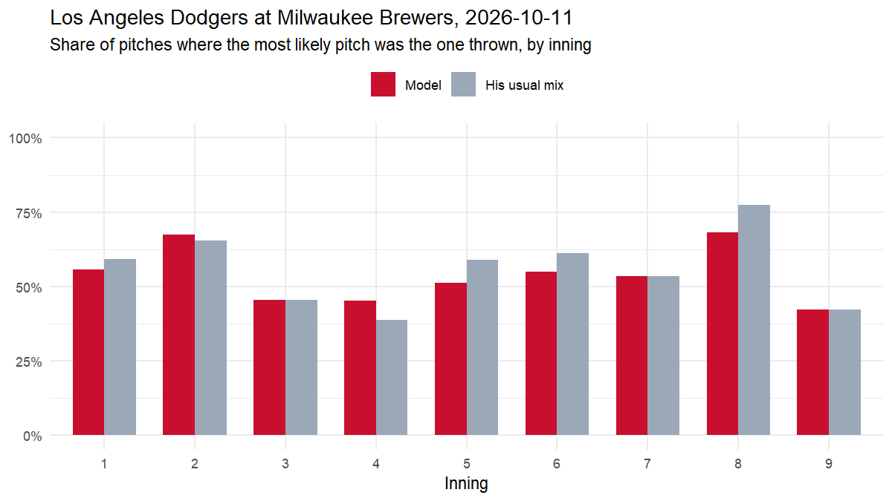

# Live test: Los Angeles Dodgers at Milwaukee Brewers, 2026-10-11

*Game 849809. Every prediction uses only what was known before the pitch. 0 of 281 predictions were logged live, before the pitch was thrown; the rest were backfilled from the pre-pitch state.*

| pitches | predicted live | model top-1 | his usual mix top-1 | model family | usual mix family | model log loss | usual mix log loss |
|---|---|---|---|---|---|---|---|
| 281 | 0 | 54.4% | 56.2% | 66.9% | 67.3% | 1.084 | 1.102 |

## By pitcher

| pitcher_name | pitches | model top-1 | usual top-1 | model log loss |
|---|---|---|---|---|
| Jacob Misiorowski | 94 | 66% | 66% | 1.05 |
| Tarik Skubal | 81 | 40% | 41% | 1.43 |
| Aaron Ashby | 26 | 73% | 73% | 0.81 |
| Trevor Megill | 19 | 42% | 42% | 0.77 |
| Evan Phillips | 17 | 41% | 41% | 1.24 |
| Alex Vesia | 16 | 44% | 56% | 0.89 |
| Abner Uribe | 15 | 67% | 67% | 0.62 |
| Tanner Scott | 9 | 56% | 78% | 0.65 |
| DL Hall | 4 | 75% | 75% | 1.10 |

## Most confident correct calls

| inning | pitcher | batter | count | predicted | thrown |
|---|---|---|---|---|---|
| top 8 | Aaron Ashby | Will Smith | 3-0 | Sinker 93% | Sinker |
| top 2 | Jacob Misiorowski | Shohei Ohtani | 3-0 | Four-seam 92% | Four-seam |
| top 3 | Jacob Misiorowski | Mookie Betts | 3-0 | Four-seam 91% | Four-seam |
| top 9 | Trevor Megill | Josue De Paula | 3-1 | Four-seam 89% | Four-seam |
| top 6 | Abner Uribe | Max Muncy | 2-0 | Sinker 80% | Sinker |

## Biggest misses

| inning | pitcher | batter | count | predicted | thrown |
|---|---|---|---|---|---|
| bottom 2 | Tarik Skubal | Cooper Pratt | 2-0 | Four-seam 39% | Curveball |
| bottom 7 | Evan Phillips | Luis Lara | 2-2 | Sweeper 42% | Sinker |
| bottom 4 | Tarik Skubal | William Contreras | 2-1 | Changeup 42% | Curveball |
| top 2 | Jacob Misiorowski | Teoscar Hernández | 1-0 | Four-seam 56% | Curveball |
| bottom 5 | Tarik Skubal | Brice Turang | 0-0 | Sinker 34% | Curveball |

*Caveat: the model was trained on regular-season games; one game is a small sample.*

