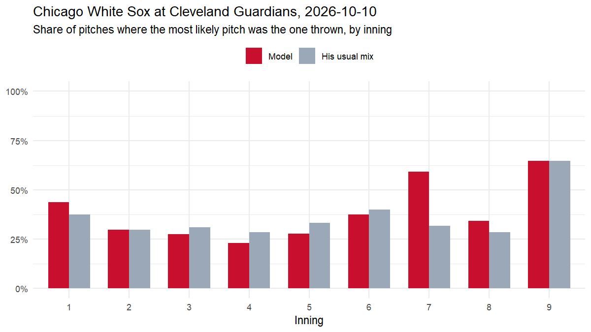

# Live test: Chicago White Sox at Cleveland Guardians, 2026-10-10

*Game 849831. Every prediction uses only what was known before the pitch. 257 of 257 predictions were logged live, before the pitch was thrown; the rest were backfilled from the pre-pitch state.*

| pitches | predicted live | model top-1 | his usual mix top-1 | model family | usual mix family | model log loss | usual mix log loss |
|---|---|---|---|---|---|---|---|
| 257 | 257 | 35.8% | 34.6% | 54.5% | 57.6% | 1.503 | 1.523 |

## By pitcher

| pitcher_name | pitches | model top-1 | usual top-1 | model log loss |
|---|---|---|---|---|
| Gavin Williams | 95 | 28% | 32% | 1.52 |
| Sean Burke | 71 | 30% | 32% | 1.80 |
| Cade Smith | 26 | 58% | 54% | 0.88 |
| Hunter Gaddis | 25 | 40% | 24% | 1.46 |
| Sean Newcomb | 24 | 46% | 38% | 1.47 |
| Grant Taylor | 12 | 33% | 25% | 1.39 |
| Erik Sabrowski | 4 | 100% | 100% | 0.64 |

## Most confident correct calls

| inning | pitcher | batter | count | predicted | thrown |
|---|---|---|---|---|---|
| top 8 | Cade Smith | Kyle Teel | 2-0 | Four-seam 89% | Four-seam |
| bottom 8 | Grant Taylor | Steven Kwan | 3-0 | Four-seam 86% | Four-seam |
| top 9 | Cade Smith | Tristan Peters | 1-1 | Four-seam 81% | Four-seam |
| top 6 | Erik Sabrowski | Munetaka Murakami | 0-2 | Four-seam 75% | Four-seam |
| top 9 | Cade Smith | Andrew Benintendi | 3-2 | Four-seam 74% | Four-seam |

## Biggest misses

| inning | pitcher | batter | count | predicted | thrown |
|---|---|---|---|---|---|
| bottom 8 | Sean Newcomb | Brayan Rocchio | 0-0 | Curveball 43% | Slider |
| top 8 | Hunter Gaddis | Kyle Teel | 0-0 | Slider 38% | Splitter |
| bottom 3 | Sean Burke | Brayan Rocchio | 3-0 | Four-seam 87% | Curveball |
| top 8 | Hunter Gaddis | Randal Grichuk | 0-0 | Slider 56% | Changeup |
| bottom 4 | Sean Burke | Jo Adell | 0-1 | Four-seam 27% | Cutter |

*Caveat: the model was trained on regular-season games; one game is a small sample.*

